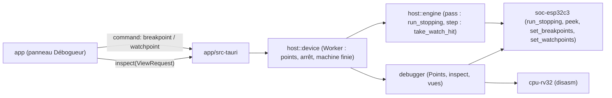

# SP4a — Le débogueur dans l'application : design

Date : 2026-10-15. Point de départ : `main` à `6691a7d` (SP2 fait). Spec globale :
`docs/superpowers/specs/2026-10-11-inkemu-design.md` §3.1 (machine déterministe), §6.2 (« console série, pause,
pas-à-pas, registres, mémoire, points d'arrêt »), §7 (ne jamais masquer une erreur). Recherche :
`docs/research/sp4-debugging.md` (RD ci-dessous). Découpage : `docs/superpowers/notes/2026-10-15-sp4-decoupage.md`.
Contrats repris : ADR 0003 (temps de l'appareil), 0007 (sessions), 0011 (crate `host`, émulateur sur un fil). ADR
de ce plan : 0016.

## 1. But

À la fin de SP4a, dans l'application de bureau, un utilisateur qui met au point un firmware peut :

1. ouvrir un panneau « Débogueur » et y lire, l'appareil en pause, arrêté ou éteint par sa fin, les 32 registres
   entiers par leurs noms ABI, le PC, le mode du processeur et ses CSR par leurs noms ;
2. lire le code autour du PC, désassemblé (RV32IMC, pseudo-instructions comme `objdump`), et à une adresse de son
   choix ;
3. lire la mémoire (ROM, SRAM, SRAM0, mémoire RTC) en hexadécimal, sans effet sur la machine ;
4. poser des points d'arrêt sur une adresse d'instruction, d'un clic dans le désassemblage ou par son adresse, et
   des points de surveillance sur des octets (lecture, écriture ou accès) ;
5. lancer : la machine s'arrête au point, l'interface dit lequel et pourquoi ; reprendre, avancer d'un pas.

Et rien de cela ne change ce que la machine exécute : une exécution arrêtée mille fois a la même empreinte de trace
qu'une exécution d'un seul tenant, et une session rejouée avec des points d'arrêt donne le verdict « identique ».

## 2. Décisions

| # | Décision | Raison |
|---|---|---|
| 4a-D1 | **Où vit le code.** `cpu-rv32` écrit une instruction (`disasm`) ; `soc-esp32c3` donne le mécanisme : arrêt à une frontière, note des accès, lecture sans effet (`debug`, `bus::debug`, `machine::debug`) ; une nouvelle crate **`debugger`**, sans E/S et compilable en WebAssembly, tient la politique (bornes, régions montrées, refus) et les vues sérialisables ; `host` porte les points d'une vie à l'autre, arrête l'exécution, sert l'inspection ; l'enveloppe Tauri traduit ; `app` affiche. La CLI ne change pas. | Règle « interface d'abord » : la logique dans des bibliothèques. Le décodeur est dans `cpu-rv32` : un désassembleur est un formateur sur son `Instr`, pas un second décodeur (RD §0, §2). `debugger` servira la version web (SP6) et le serveur GDB (SP4d). |
| 4a-D2 | **Un point d'arrêt arrête avant son instruction**, qui n'est pas exécutée, quand le processeur va l'exécuter ; l'appel qui suit un arrêt ou un pas repart au-delà du point où il est (`breakpoint_left`), et la machine s'arrête de nouveau quand elle y revient. Il n'arrête pas un processeur qui attend en `wfi` (son PC est alors l'instruction après le `wfi`), ni quand une interruption est prise d'abord (il arrête au retour du gestionnaire), ni endormi profondément, ni sans alimentation. Aucune adresse n'est refusée hors des régions sans code (périphériques, rien). Ajouté après la relecture : `Hart::executes_next`. | Sémantique de GDB (`Z0`) ; un arrêt à une frontière est l'arrêt d'une limite de cycles, que la machine sait déjà couper n'importe où (RD §0). |
| 4a-D3 | **Un point de surveillance** note les chargements et rangements **du processeur** (pas les lectures d'instruction ni les accès d'un périphérique), réussis, qui touchent ses octets ; la machine s'arrête après l'instruction, à la frontière suivante. Une instruction fait un accès : le premier est gardé. Une raison de la machine (arrêt strict, sortie de console) et un accès surveillé au même tour : la raison de la machine d'abord, l'accès arrête l'appel suivant avant toute instruction. La SRAM est surveillée à travers ses deux vues. | Ce que GDB appelle `watch`, `rwatch`, `awatch` (RD §1) ; sans perte : un arrêt strict ne cache pas l'accès. |
| 4a-D4 | **Aucun arrêt ne change l'exécution.** `Esp32C3::run_within` et `run_stopping` partagent la même boucle ; les crochets du débogueur lisent la machine à une frontière et ne font rien d'autre. Preuve : une exécution coupée à chaque point a la même empreinte de trace, les mêmes cycles, le même temps d'appareil, les mêmes registres et la même mémoire qu'une exécution d'un seul tenant ; une session rejouée avec des points donne « identique ». Aucune empreinte figée ne bouge. | Spec §3.1 et la consigne du sous-projet : un point d'arrêt ne change pas l'exécution. |
| 4a-D5 | **Lecture sans effet** (`Esp32C3::peek`) : ROM et RAM comme elles sont ; fenêtre de flash par l'entrée de MMU, sans fait de cache ni registre de faute ; registre de périphérique **jamais lu** (une lecture peut le changer : FIFO, bit effacé à la lecture) ; rien n'est signalé. | Un débogueur qui change ce qu'il regarde ment (spec §7). |
| 4a-D6 | **Le contenu de la flash n'est pas montré** (ADR 0016) : la vue mémoire ne montre ni la fenêtre de données ni celle d'instructions de la flash (« contenu de la flash, non montré ») ; le désassemblage lit la fenêtre d'instructions, et dans elle les seules pages de 64 Kio d'où le processeur a chargé une instruction pendant cette vie (notées par le bus sur le chemin du fetch ; toute autre page est « non exécutée », ajouté après la relecture de la PR #21), et n'en montre que le texte décodé, sans encodage ; un point de surveillance est refusé sur une fenêtre de flash. Rien de ce que lit le débogueur ne va dans le journal, un fichier, une session ou la sortie de la CLI. | Règle du dépôt : aucun octet de flash affiché, la NVS d'un appareil réel pouvant contenir des données personnelles. ESP-IDF lit la NVS par SPI1, pas par les fenêtres ; la fenêtre d'instructions porte le code de l'application. |
| 4a-D7 | **Bornes** : 64 points d'arrêt, 16 points de surveillance de 1 à 4 096 octets, une vue mémoire de 1 024 octets au plus, un désassemblage de 64 lignes au plus. Un point d'arrêt est sur une adresse paire. Un dépassement est un refus nommé. | Une recherche dichotomique par frontière et un parcours par accès restent négligeables ; l'ESP32-C3 lui-même a 8 + 8 déclencheurs (RD §3). |
| 4a-D8 | **Les points appartiennent à l'émulateur**, pas à la vie : ils survivent à un reset et à une nouvelle vie, se posent pendant un rejeu (ils ne changent rien), et ne sont dans aucune session. | Ce qu'attend un utilisateur qui relance son firmware. |
| 4a-D9 | **Un arrêt met la course en pause** (`RunState::Paused`) et se dit deux fois : `Status.stop` (point d'arrêt et son PC, ou accès surveillé : adresse, taille, sens, valeur, PC de l'instruction) et une ligne du journal. « Lancer », « Pas », « Reset » et une nouvelle vie l'effacent ; un pas qui touche des octets surveillés le dit à son tour. | Spec §7 : ne rien masquer ; l'annonce aux lecteurs d'écran passe par la ligne d'état. |
| 4a-D10 | **L'inspection** (`Handle::inspect(ViewRequest) -> DebugView`) est servie par le fil entre deux passes, comme une commande, même pendant la course (instantané à une frontière de passe). À la fin d'une vie, la machine est gardée jusqu'à la suivante : son état final (registres, mémoire, code) reste lisible. | Une fin de vie (arrêt strict, faute, limite) est ce qu'on veut le plus examiner. |
| 4a-D11 | **CSR montrés** : ceux que le cœur a (ceux que `Esp32C3::csr` lit), dans un ordre fixe, par leurs noms ; registres et CSR en **lecture seule**. | Écrire un registre ou la mémoire changerait l'exécution sans entrer au journal d'une session : SP4d tranchera pour `G`, `P`, `M` de GDB. |
| 4a-D12 | **Le panneau** s'ouvre par un bouton de la barre (`aria-expanded`, `aria-controls`), sous l'appareil : registres et CSR en tableaux à en-têtes, désassemblage en liste dont la ligne du PC porte `aria-current`, chaque ligne avec un bouton de point d'arrêt (`aria-pressed`), une vue mémoire en tableau (adresse, 16 octets, ASCII), deux formulaires étiquetés (point d'arrêt, point de surveillance) et leurs listes avec « retirer ». Il se rafraîchit à chaque statut quand la course n'avance pas, et à la demande pendant qu'elle avance. FR et EN, contrastes et focus du thème. | « Interface d'abord » ; accessibilité de SP2c (2c-R…). |
| 4a-D13 | **Aucune entrée nouvelle** dans les sessions, aucune option nouvelle de la CLI ; `inkemu gdb` est SP4d. | Le débogueur ne change ni la machine ni ses entrées. |

## 3. Architecture

| Où | Possède |
|---|---|
| `cpu-rv32/src/disasm.rs` | `ABI_NAMES`, `register_name`, `csr_name`, `disassemble` |
| `soc-esp32c3/src/debug.rs` | `Watch`, `WatchOn`, `Access`, `WatchHit`, `DebugStop`, `RunStop`, `Peeked` |
| `soc-esp32c3/src/bus/debug.rs` | la note des accès, `peek_byte` |
| `soc-esp32c3/src/machine/debug.rs` | `set_breakpoints`, `set_watchpoints`, `run_stopping`, `take_watch_hit`, `peek`, `privilege` ; les crochets `Stops` |
| `crates/debugger` | `Points`, `PointError`, `Region`, `ViewRequest`, `DebugView`, `CpuView`, `Line`, `MemoryView`, `StopView`, `inspect` |
| `host/src/engine.rs`, `host/src/device.rs` | `Engine::set_points`, `Output.stop`, `Engine::inspect` ; `Command::Breakpoint`, `Command::Watchpoint`, `Handle::inspect`, `Status.stop`, la machine d'une vie finie |
| `app/src-tauri/src/commands.rs` | `CommandDto::Breakpoint`, `CommandDto::Watchpoint`, commande `inspect` |
| `app/src` | types, `HostApi.inspect`, `DebugPanel`, bouton de la barre, traductions |

## 4. Le contrat de l'inspection

`ViewRequest { disassemblyAt: number | null, disassemblyLines: number, memory: { address, length } | null }`.

`DebugView` :

- `cpu` : `pc`, `privilege` (`machine` | `user`), `asleep`, `registers` (32 : `number`, `name`, `value`), `csrs`
  (`address`, `name`, `value`) ;
- `disassembly` : lignes `address`, `length` (2, 4 ; 0 illisible), `text`, `compressed`, `current`, `breakpoint`,
  `readable` (faux : région sans code ou flash non adossée) ;
- `memory` : `address`, `bytes` (un octet ou `null` par position), `regions` (plages consécutives : `rom`, `sram`,
  `sram0`, `rtc`, `flash`, `registers`, `unbacked`, `unmapped`) — `null` sans demande ;
- `points` : `breakpoints` (adresses croissantes), `watchpoints` (`address`, `length`, `on` : `read` | `write` |
  `access`).

`Status.stop` : `null`, `{ kind: "breakpoint", pc }` ou `{ kind: "watchpoint", address, size, access, value, pc }`.

Commandes : `{ kind: "breakpoint", address, set }`, `{ kind: "watchpoint", address, length, on, set }`. Refus :
genre `point`, message de l'hôte avec la cause et le remède.

## 5. Tests et critères d'acceptation

1. `cpu-rv32` : chaque forme écrite comme `objdump` (pseudo-instructions, cibles absolues, CSR nommés ou en
   hexadécimal, comprimées développées, illégale sans ses bits).
2. `soc-esp32c3` : arrêt avant l'instruction, puis au-delà ; arrêt avant tout au vecteur de reset ; surveillance
   après l'instruction avec sa valeur et son PC ; **une exécution coupée à chaque point égale une exécution d'un
   seul tenant** (empreinte, cycles, instructions, temps, registres, mémoire) ; pas d'arrêt d'un processeur en
   `wfi` ; accès surveillé et arrêt strict au même tour ; un pas ne rend que son accès ; lecture sans effet (aucun
   diagnostic, aucun état de cache) ; vues de la SRAM ; débordement en haut de l'espace d'adresses.
3. `debugger` : bornes et refus nommés ; régions ; vue mémoire qui ne montre ni flash ni registres ; désassemblage
   autour du PC qui tombe sur le PC, lignes illisibles, points marqués ; CSR du cœur ; sérialisation camelCase.
4. `host` : un arrêt met en pause et se dit (statut, journal) ; « Lancer » repart au-delà ; les points survivent à
   un reset ; un pas sur un rangement surveillé le dit ; l'état final d'une vie finie se lit ; **un rejeu avec des
   points d'arrêt donne « identique »** ; refus nommés.
5. Enveloppe Tauri : les nouvelles commandes se traduisent, `inspect` répond.
6. `app` : le panneau s'ouvre et se ferme depuis la barre ; registres, CSR, désassemblage, mémoire, points rendus
   d'après une vue ; un clic pose et retire un point ; les formulaires refusent une adresse illisible ; l'arrêt est
   dit ; FR et EN complets.
7. Aucune empreinte figée ne bouge ; `cargo check --target wasm32-unknown-unknown -p debugger` ; `debugger` dans
   l'interdiction des E/S de l'hôte (`clippy.toml`, `host_io_ban.rs`).

## 6. Hors périmètre, et héritiers

| Sujet | Héritier |
|---|---|
| Symboles d'un ELF, pile d'appels, tâches FreeRTOS, serveur GDB, écrire un registre ou la mémoire | SP4d |
| Moniteur de ressources | SP4b |
| Vue technique de l'écran, appareil vivant | SP4c |
| Scénarios, régression visuelle | SP4e |
| Déclencheurs de la puce, `ASSIST_DEBUG`, `SENSITIVE`, `rv32mi-p-breakpoint` | SP4f |
| Montrer la fenêtre de données de la flash pour les sections d'un ELF fourni | SP4d |
