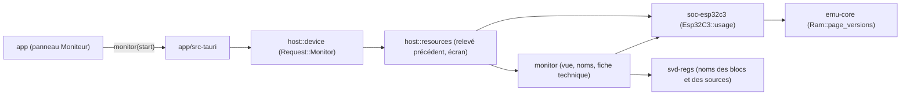

# SP4b — Le moniteur de ressources : design

Date : 2026-10-15. Point de départ : `main` à `5a28566` (SP4a fait : le débogueur dans l'application). Spec globale :
`docs/superpowers/specs/2026-10-11-inkemu-design.md` §3.1 (machine déterministe), §6.1 (« le moniteur ne montre que des
valeurs mesurées ; quand une valeur n'est pas mesurable, il l'indique au lieu d'afficher une estimation »), §7 (ne
jamais masquer une erreur). Recherche : `docs/research/sp4b-resource-monitor.md` (RM ci-dessous). Découpage :
`docs/superpowers/notes/2026-10-15-sp4-decoupage.md`. Contrats repris : ADR 0003 (temps de l'appareil), 0007
(sessions), 0011 (émulateur sur un fil), 0016 (débogueur, flash non montrée). ADR de ce plan : 0017.

## 1. But

À la fin de SP4b, dans l'application de bureau, un utilisateur qui met au point un firmware ouvre un panneau
« Moniteur » et y lit, pendant que l'appareil tourne (relu chaque seconde) ou quand il est arrêté :

1. **le processeur** : fréquence courante, cycles, instructions, rapport de vitesse émulée/réelle, resets ;
2. **le temps de l'appareil** : part passée à exécuter, à attendre en `wfi`, en sommeil profond ; la **charge** (part
   du temps éveillé hors `wfi`) depuis la mise sous tension et sur la dernière fenêtre ; le temps passé à chaque
   fréquence ;
3. **la mémoire vive** : pour la SRAM, la SRAM0 et la mémoire RTC, les pages de 4 Kio écrites depuis la mise sous
   tension et depuis le dernier reset, en carte et en chiffres, la plus basse et la plus haute adresse écrites, le
   nombre d'écritures ;
4. **l'activité** : les interruptions levées par source et prises par ligne du processeur, les accès du processeur aux
   registres de chaque bloc de périphérique, les rafraîchissements de l'écran ;
5. **une estimation de la consommation de la puce** tirée de la fiche technique et dite telle : une fourchette de
   courant par état (exécution ou attente à 160 et 80 MHz, sommeil profond), la charge consommée, et le temps passé là
   où la fiche ne donne aucune valeur.

Et rien de cela ne change ce que la machine exécute : une exécution observée à chaque frontière a la même empreinte de
trace qu'une exécution jamais observée, et un rejeu observé donne « identique ». Fermé, le moniteur ne coûte rien de
mesurable.

## 2. Décisions

| # | Décision | Raison |
|---|---|---|
| 4b-D1 | **Où vit le code.** `emu-core` donne les versions de pages qu'une `Ram` tient déjà (`Ram::version`, `Ram::page_versions`) ; `soc-esp32c3` compte (`usage`, `machine/usage.rs`, `bus/usage.rs`) et donne un relevé, `Esp32C3::usage() -> Usage`, en lecture seule ; une nouvelle crate **`monitor`**, sans E/S et compilable en WebAssembly, fait du relevé une vue sérialisable (régions et blocs nommés, charge, fenêtre récente, consommation de la fiche technique) ; `host` sert la vue (`Handle::monitor`), garde le relevé précédent et l'usage de l'écran ; l'enveloppe Tauri traduit ; `app` affiche. La CLI ne change pas. | Règle « interface d'abord » : la logique dans des bibliothèques, aucune en TypeScript. `monitor` servira la version web (SP6) et les rapports des scénarios (SP4e). |
| 4b-D2 | **Ne compter qu'où le temps et les événements passent déjà**, jamais par instruction : le temps d'attente aux quatre `sleep_until` de `sleep` et `sleep_deeply`, le temps par fréquence au changement d'horloge (`retune`), les interruptions prises au tour qui les prend, les sources levées quand le contrôleur les échantillonne (`select_interrupt`), un accès de registre dans `mmio_read`/`mmio_write`. Les pages écrites ne coûtent rien de nouveau : ce sont les versions de pages du cache de décodage. Le temps d'exécution est le reste. | Coût négligeable quand le moniteur est fermé (consigne). RM §1. |
| 4b-D3 | **Le compte ne s'arrête jamais**, que le panneau soit ouvert ou non : un relevé dit ce qui s'est passé depuis la mise sous tension, et l'ouverture du panneau ne change rien. Le relevé (`usage`) n'est fait qu'à la demande. | Une mesure qui commence à l'ouverture du panneau ne dirait pas le démarrage ; le coût d'un compte permanent est mesuré (4b-D11). |
| 4b-D4 | **Observer ne change rien.** `usage` prend `&self` ; aucun compteur n'est lu par l'exécution. Preuve : une exécution coupée en appels avec un relevé après chacun a la même empreinte de trace, les mêmes cycles, instructions, temps d'appareil, registres et mémoire qu'une exécution d'un seul tenant, **et le même relevé final** (le compte ne dépend pas des coupures) ; une session rejouée avec le moniteur lu à chaque statut donne « identique ». Aucune empreinte figée ne bouge. | Consigne du sous-projet ; spec §3.1. |
| 4b-D5 | **La mémoire vive au grain de la page de 4 Kio** : une page est « jamais écrite », « écrite avant le dernier reset » ou « écrite depuis » ; la plus basse et la plus haute adresse écrites sont des bornes de pages. Le contenu n'est jamais montré, seulement quelles pages ont été écrites. « Occupation » au sens d'un allocateur (le tas) : SP4d, avec les symboles. | Mesure gratuite (RM §1) ; une granularité plus fine coûterait un test par rangement. Spec §6.1 : le tas « seulement si ses structures ESP-IDF sont reconnues ». |
| 4b-D6 | **L'activité des périphériques** : les accès du processeur aux registres, lectures et écritures, par bloc de 2 Kio de la fenêtre des périphériques, nommé par les blocs du SVD qu'il contient (`APB_CTRL, RNG` ensemble) ; les interruptions levées par source (front montant vu par le contrôleur, nommée par son registre de routage sans `_MAP`) et prises par ligne ; les rafraîchissements de l'écran de la vie (nombre, nature du dernier), comptés par l'hôte. Le détail par périphérique (octets SPI, transactions I2C, conversions ADC, blocs de la carte) demande des crochets dans les modèles de `soc-esp32c3` et de `chips` : SP4c pour la carte et l'écran, à la demande pour le reste. | Mesuré, sans connaître le firmware, hors des fichiers que SP3 change. RM §1. |
| 4b-D7 | **Charge** = temps éveillé hors `wfi` / temps éveillé, en pour mille ; depuis la mise sous tension, et sur la **fenêtre récente** : entre le relevé précédent servi au panneau et celui-ci, dans la même vie (sinon aucune fenêtre). Le panneau relit chaque seconde : la fenêtre est la dernière seconde. | La charge cumulée depuis la mise sous tension écrase le présent ; la fenêtre se calcule en Rust, pas dans l'interface. |
| 4b-D8 | **Consommation : la fiche technique, dite telle.** ESP32-C3 Series Datasheet v2.4, tableaux 5-8 et 5-9 (RM §3) : à 160 et 80 MHz, une fourchette « toutes horloges de périphériques coupées » à « toutes en marche », processeur en exécution ou en attente ; sommeil profond 5 µA. Aucune valeur aux autres fréquences (20 et 40 MHz : le démarrage) : leur temps est dit « sans valeur de la fiche technique » et n'entre pas dans la charge consommée, que le panneau dit alors partielle. Puce seule, typique, sans l'écran ni la carte ni le surcoût des accès à la flash. | Spec §6.1 : « consommations datasheet signalées comme telles » ; ne pas inventer une valeur que la source ne donne pas. |
| 4b-D9 | **Registres d'alimentation** (`RTC_CNTL.OPTIONS0`, `PWC`, `DIG_PWC` hors `DG_WRAP_PD_EN`, `BIAS_CONF`, `SDIO_CONF`, `SYSTEM.MEM_PD_MASK`) : restent acceptés sans effet, leur héritier devient **SP8** (le banc de calibration). La fiche technique ne donne aucune valeur par domaine : seule une mesure sur matériel leur donnerait un effet visible. | RM §3 ; ne pas modéliser ce qu'aucune source ne chiffre. |
| 4b-D10 | **Batterie et câble** : pas dans SP4b. Ils sont fixés à la mise sous tension (ADR 0013) et deviennent des entrées vivantes dans SP4c, qui les ajoutera au moniteur. **Tâches FreeRTOS, piles des tâches, tas** : SP4d (symboles). | Une valeur figée n'est pas une mesure ; les lecteurs du câble (`boards`, catalogue de `host`) sont la zone de SP3 en parallèle. |
| 4b-D11 | **Coût mesuré** par un banc (`crates/soc-esp32c3/tests/throughput.rs`, ignoré par défaut, lancé en `--release`) : instructions par seconde de trois programmes (calcul et rangements en SRAM ; lectures d'un registre de périphérique ; interruptions et `wfi`), sur `main` et sur la branche, au plus de cinq passes. Le résultat est écrit dans la note de passation. | Consigne : « mesure-le ». Le dépôt n'avait pas de banc. |
| 4b-D12 | **Le panneau** s'ouvre par un bouton de la barre (`aria-expanded`, `aria-controls`). Fermé, il ne demande rien à l'hôte. Ouvert, il relit chaque seconde pendant que l'appareil tourne, et une fois à chaque changement sinon. Sections titrées, tableaux à en-têtes, carte des pages en image (`role="img"`) avec son texte, mention « fiche technique » visible à côté de chaque valeur de courant. FR et EN ; nombres au format de la langue. | « Interface d'abord » ; accessibilité de SP2c et SP4a. |
| 4b-D13 | **Aucune entrée nouvelle** dans les sessions, aucune option nouvelle de la CLI ; le moniteur ne montre aucun octet de mémoire ni de flash. | Le moniteur ne change ni la machine ni ses entrées (ADR 0016 §6 vaut ici). |

## 3. Architecture

| Où | Possède |
|---|---|
| `emu-core/src/memory.rs` | `Ram::version`, `Ram::page_versions` |
| `soc-esp32c3/src/usage.rs` | `Usage`, `ClockUse`, `BlockUse`, `MemoryUse`, `BLOCK_BYTES`, `SOURCES`, `LINES` |
| `soc-esp32c3/src/machine/usage.rs` | `Counters` (temps par fréquence, attente, sommeil profond, interruptions, marques de reset), `Esp32C3::usage` |
| `soc-esp32c3/src/bus/usage.rs` | accès par bloc, pages des RAM |
| `monitor` (nouvelle) | `MonitorView` et ses parties, `view(&Usage, Option<&Usage>, HostSide)`, `power` (fiche technique), `names` |
| `host/src/resources.rs` | `Resources` : relevé précédent de la vie, usage de l'écran, `view` |
| `host/src/device.rs` | `Request::Monitor`, `Handle::monitor`, `Emulator::monitor` |
| `app/src-tauri/src/commands.rs` | commande `monitor` |
| `app/src` | `MonitorPanel`, `monitor-format.ts`, bouton de la barre, FR/EN |

## 4. Ce que dit la vue

- `deviceTimeNanos`, `cycles`, `instructions`, `cpuHz`, `resets`, `speedRatio` (de l'hôte, `null` hors course).
- `time` : `runningNanos`, `waitingNanos`, `deepSleepNanos`, `loadPermille` (`null` sans temps éveillé).
- `recent` : la même chose sur la fenêtre, plus `instructions`, `interrupts` (levées), `registerAccesses` ; `null` au
  premier relevé d'une vie ou quand le temps n'a pas avancé.
- `clocks[]` : `hz`, `runningNanos`, `waitingNanos`, dans l'ordre de première utilisation.
- `memories[]` : `region` (`sram`, `sram0`, `rtcFast`), `base`, `size`, `pageBytes`, `pages[]` (`never`, `before`,
  `since`), `written`, `writtenSinceReset`, `lowest`, `highestEnd` (`null` sans page écrite), `writes`,
  `writesSinceReset`.
- `interrupts[]` : `source`, `name`, `raised`, `recent` (sources jamais levées omises) ; `lines[]` : `line`, `taken`.
- `peripherals[]` : `base`, `name`, `reads`, `writes`, `recent` (blocs jamais accédés omis).
- `power` : `source` (référence de la fiche), `rows[]` (`state` `running`, `idle` ou `deepSleep`, `hz`, `nanos`,
  `microamps` `[min, max]` ou `null`, `microampHours` `[min, max]` ou `null`), `microampHours` `[min, max]`,
  `unpricedNanos`.
- `panel` : `refreshes`, `last` (`full` ou `partial`), `null` avant le premier rafraîchissement.

## 5. Tests

- `emu-core` : versions des pages et compteur d'écritures.
- `soc-esp32c3` : attente et sommeil profond comptés, temps par fréquence après un changement d'horloge, interruptions
  levées et prises, accès de registres par bloc, pages écrites avant et depuis un reset ; **un relevé après chaque
  coupure ne change ni l'exécution ni le relevé final**, sous les deux tarifs ; banc ignoré.
- `monitor` : charge, fenêtre récente, noms des blocs et des sources, consommation (fourchettes, temps sans valeur),
  états des pages, forme JSON.
- `host` : la vue d'une vie en marche, en pause, finie ; la fenêtre récente ; l'écran compté ; **un rejeu observé à
  chaque statut est « identique »**.
- enveloppe : la commande lit l'émulateur de son lancement.
- `app` (Vitest) : bouton, sections, formats en FR et EN, relecture à l'intervalle seulement pendant la course et
  jamais panneau fermé.
